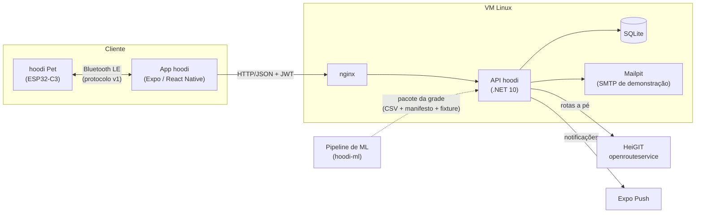
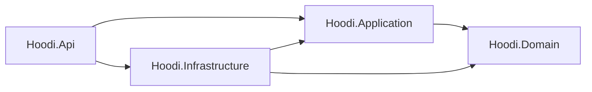
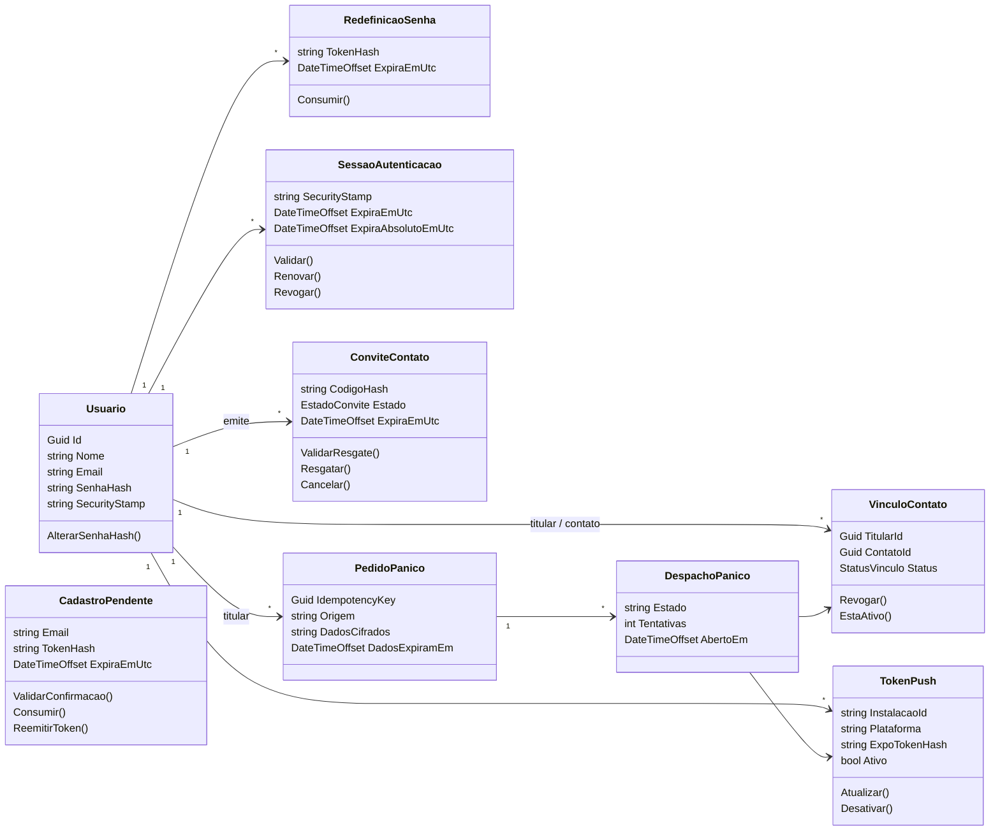

# hoodi

Comparação de rotas a pé pelo risco histórico do caminho, com alerta discreto no **hoodi Pet** e pedido de ajuda para contatos de confiança.

Este repositório reúne a **API de backend em .NET 10** (pasta raiz) e as demais partes da solução: dispositivo IoT, infraestrutura da VM e análise de privacidade. O aplicativo móvel (Expo) e o pipeline de Machine Learning ficam em repositórios próprios, listados em [Estrutura do repositório](#estrutura-do-repositório).

## Ficha da CitizenTech

| | |
| --- | --- |
| **Nome** | hoodi |
| **Cidade e bairro** | São Paulo/SP: região da Avenida Paulista (Bela Vista, Consolação, Cerqueira César, Jardins e Paraíso), num perímetro piloto de 5 × 5 km |
| **Cidadão beneficiado** | Pessoas que se deslocam a pé à noite, em especial estudantes de cursos noturnos |
| **Problema, em uma frase** | Quem volta a pé à noite não tem como comparar, antes de sair, o risco histórico dos caminhos possíveis, e consultar o celular na rua aumenta a exposição. |
| **Como funciona** | O app envia origem, destino e horário de saída. A API busca até três alternativas a pé, cruza cada trecho com uma grade de risco construída a partir de registros públicos da SSP-SP e devolve as rotas ordenadas. Durante o trajeto, o hoodi Pet sinaliza mudanças de nível por vibração e expressão. Segurar o botão do Pet por 3 s dispara um pedido de ajuda para os contatos de confiança. |
| **O que cada parte faz** | **API .NET:** contas, contatos, pânico, grade e avaliação de rotas. **App Expo:** interface, GPS e ponte Bluetooth com o Pet. **hoodi Pet (ESP32-C3):** alerta físico e botão de ajuda. **ML:** produção da grade de risco por célula H3 e faixa horária. **VM Linux:** hospedagem e monitoramento. **Cybersecurity:** detecção de dados pessoais no código. |
| **Link do repositório** | https://github.com/APB-Abner/Hoodi |
| **Indicador de impacto** | Diferença do índice de risco acumulado (`pontuacao.acumulada`) entre a rota recomendada e a de maior risco entre as alternativas de cada avaliação |
| **ODS conectados** | ODS 11, Cidades e comunidades sustentáveis (meta 11.7: espaços públicos seguros). ODS 16, Paz, justiça e instituições eficazes (meta 16.1: reduzir a violência). |

## Integrantes

| Integrante | RM | Responsabilidade |
| --- | --- | --- |
| Abner de Paiva Barbosa | RM558468 | API .NET (domínio, EF Core, migrations, contratos e testes) e simulação do hoodi Pet |
| Beatriz Vieira de Novais | RM554746 | VM Linux, serviços, monitoramento e análise de privacidade (PII) |
| Fernando Luiz Silva Antonio | RM555201 | Grade de risco (Machine Learning) e firmware do hoodi Pet |
| Mariana Neugebauer Dourado | RM550494 | Aplicativo Expo, Bluetooth e integração com a API |

## Arquitetura da solução



- O **app** concentra GPS, regra de alerta e comunicação com o Pet. O Pet nunca chama a API.
- A **API** é a única dona dos dados. Ela expõe serviços REST versionados em `/v1` e isola os provedores externos atrás de interfaces.
- A **grade de risco** é produzida fora da API e publicada por importação autenticada, com verificação de SHA-256 dos artefatos aprovados.

## Estrutura do repositório

| Caminho | Conteúdo |
| --- | --- |
| [`Hoodi.Domain`](Hoodi.Domain) | Entidades, invariantes e exceções de domínio, sem dependência de infraestrutura |
| [`Hoodi.Application`](Hoodi.Application) | Contratos de entrada e saída, interfaces dos serviços e casos de uso (avaliação de rotas, importação da grade) |
| [`Hoodi.Infrastructure`](Hoodi.Infrastructure) | EF Core/SQLite, migrations, implementação dos serviços e adaptadores HeiGIT, Expo e H3 |
| [`Hoodi.Api`](Hoodi.Api) | Controllers, autenticação JWT, rate limiting, tratamento de erros, workers e OpenAPI/Scalar |
| [`Hoodi.Tests`](Hoodi.Tests) | Testes unitários e de integração (xUnit) |
| [`contracts`](contracts) | Contrato OpenAPI do projeto e baselines preservadas |
| [`data`](data) | Artefatos de grade e vetores de referência copiados do produtor, com hashes em `SOURCE.md` |
| [`docs`](docs) | Documentação técnica por módulo |
| [`deploy`](deploy) | Modelos de systemd, nginx e EnvironmentFile |
| [`infra`](infra/README.md) | Provisionamento da VM por shell script, monitoramento e evidências (Operating Systems) |
| [`security`](security/README.md) | Regras Semgrep de PII, taint analysis e dashboard Risco Cidadão (Cybersecurity) |
| [`iot`](iot/README.md) | Firmware do hoodi Pet, protocolo BLE e simulação no Wokwi (Physical Computing) |

Repositórios relacionados: aplicativo Expo em `NeugeMa/hoodi` e pipeline de ML em [`nandoantonio-git/hoodi-ml`](https://github.com/nandoantonio-git/hoodi-ml).

## Arquitetura da API

A API segue uma arquitetura em camadas com dependências apontando para dentro:



- **Controllers finos:** validam a entrada pelo model binding e delegam a uma interface da Application (`IAutenticacaoService`, `IContatosService`, `IPanicoService`, `IAvaliacaoRotas`...).
- **Casos de uso independentes de provedor:** `AvaliacaoRotasService` depende só de portas (`IProvedorRotas`, `IGradeParaRotas`, `IPoliticaRotas`, `IIndiceEspacialRotas`). HeiGIT, SQLite e H3 entram como adaptadores na Infrastructure. Veja [fronteira da Application](docs/route-application-boundary.md).
- **Injeção de dependência:** tudo é registrado no contêiner nativo do ASP.NET Core (`Program.cs`). `TimeProvider` é injetado para tornar prazos testáveis, e `HttpClient` tipado é usado nos provedores externos.
- **Processamento em segundo plano:** dois `BackgroundService` consomem filas persistidas. `EmailOutboxWorker` faz a outbox de e-mail cifrada e `PanicoWorker` faz o despacho de pedidos de ajuda com novas tentativas.
- **Erros padronizados:** respostas de erro em `ProblemDetails` com código estável. `DomainException` vira 409 (ou 422 para `VINCULO_PROPRIO`). Detalhes de exceção nunca são enviados ao cliente.
- **Assíncrono de ponta a ponta:** o acesso a banco e a HTTP externo usa `async/await` com `CancellationToken` propagado desde o controller.

### Serviços

| Serviço | Responsabilidade | Prefixo |
| --- | --- | --- |
| Autenticação | Cadastro com prova de posse do e-mail, login, refresh rotativo, recuperação de senha e logout | `/v1/auth` |
| Conta | Exclusão transacional da conta, com confirmação por senha | `/v1/conta` |
| Contatos | Convites de uso único e vínculos de contatos de confiança | `/v1/contatos` |
| Push | Registro e desativação de tokens Expo por instalação | `/v1/push/tokens` |
| Pânico | Pedido de ajuda idempotente, despacho aos contatos e confirmação de abertura | `/v1/panico` |
| Grade de risco | Publicação atômica e consulta da grade H3 por faixa horária | `/v1/risco`, `/v1/admin/risco` |
| Rotas | Busca de alternativas a pé, pontuação por trecho e ranking | `/v1/rotas` |

## Modelo de domínio



As entidades de `Hoodi.Domain` encapsulam seu estado (setters privados) e expõem apenas operações que preservam as invariantes:

- **Contatos:** um usuário não pode ser contato de si mesmo (`VINCULO_PROPRIO`). O convite é de uso único, expira em 60 minutos por padrão e, depois de aceito, rejeitado ou cancelado, não pode ser resgatado de novo (`CONVITE_ENCERRADO`). Só existe um vínculo ativo por par titular → contato.
- **Sessões:** a sessão expira após 7 dias sem renovação e nunca ultrapassa 30 dias desde o login. Redefinir a senha muda o security stamp e invalida as sessões anteriores (`SESSAO_INVALIDA`).
- **Tokens de confirmação e recuperação:** distintos, de uso único, válidos por 30 minutos e armazenados apenas como hash (`TOKEN_INVALIDO`).
- **Prazos:** todos os instantes são `DateTimeOffset` em UTC, recebidos explicitamente (`agoraUtc`) em vez de lidos do relógio do sistema.

Registros técnicos ficam na Infrastructure, sem regra de negócio própria:

| Registro | Papel |
| --- | --- |
| `RefreshRegistro` | Hash do refresh token e resposta de replay cifrada |
| `EmailPendente` | Outbox de e-mail cifrada |
| `PedidoPanico` / `DespachoPanico` | Pedido de ajuda e despacho por contato e token |
| `SnapshotArtifact` / `SnapshotHead` | Pacote da grade publicado e ponteiro da versão atual |

## Persistência

- **Banco:** SQLite via Entity Framework Core 10 (`HoodiDbContext`), com índices únicos para e-mail, hashes de token, código de convite, vínculo ativo e chave de idempotência do pânico.
- **Migrations** em [`Hoodi.Infrastructure/Persistence/Migrations`](Hoodi.Infrastructure/Persistence/Migrations), aplicadas automaticamente na inicialização:

  | Migration | Conteúdo |
  | --- | --- |
  | `InitialAuthentication` | Usuários, cadastros pendentes, sessões, refresh tokens, redefinições e outbox de e-mail |
  | `ContactsAndPush` | Convites, vínculos e tokens push |
  | `SnapshotPublicationSkeleton` | Publicação versionada da grade de risco |
  | `PanicAndAccountDeletion` | Pedidos e despachos de pânico e suporte à exclusão de conta |
  | `PanicOwnerRetention` | Prazo de retenção separado para o titular do pedido |

- **Consultas LINQ** traduzidas para SQL, por exemplo a listagem de convites pendentes em `ContatosService`:

  ```csharp
  db.Convites
      .Where(x => x.TitularId == titularId && x.Estado == EstadoConvite.Pendente && x.ExpiraEmUtc > agora)
      .OrderBy(x => x.CriadoEmUtc).ThenBy(x => x.Id)
      .Select(x => new ConvitePendenteResumo(x.Id, x.ExpiraEmUtc, "pendente", "titular_para_contato"))
      .ToListAsync(ct);
  ```

- **Datas no SQLite:** o provedor não traduz comparações de `DateTimeOffset`. Nos convites, os prazos são gravados como ticks UTC inteiros para que o filtro de expiração rode no próprio SQL. Detalhes em [UTC no domínio](docs/utc-timestamps.md).

Verificar se o modelo e as migrations estão sincronizados:

```bash
dotnet ef migrations has-pending-model-changes --project Hoodi.Infrastructure --startup-project Hoodi.Api -- --environment Development
```

## Endpoints

Documentação automática gerada pela própria API:

| Recurso | Caminho |
| --- | --- |
| Interface interativa (Scalar) | `/scalar` |
| Documento OpenAPI | `/openapi/v1.json` |
| Saúde da API e do banco | `/health` |

O contrato de projeto completo está em [`contracts/openapi.yaml`](contracts/openapi.yaml) (`0.6.0-draft`), com incrementos em [`contracts/v0.6`](contracts/v0.6) e baselines v0.5.1 a v0.5.3 preservadas. A versão vem de `<Version>` em `Hoodi.Api.csproj` e é a mesma em `/health` e no OpenAPI gerado ([versionamento](docs/api-version-contract.md)).

| Método | Rota | Autenticação | Descrição |
| --- | --- | --- | --- |
| POST | `/v1/auth/registrar` | – | Inicia o cadastro; resposta 202 genérica |
| POST | `/v1/auth/confirmar-email` | – | Confirma o e-mail e cria a conta |
| POST | `/v1/auth/login` | – | Emite access JWT e refresh token |
| POST | `/v1/auth/renovar` | – | Rotaciona o refresh token |
| POST | `/v1/auth/solicitar-redefinicao` | – | Inicia a recuperação de senha; resposta 202 genérica |
| POST | `/v1/auth/redefinir-senha` | – | Altera a senha e invalida as sessões anteriores |
| POST | `/v1/auth/sair` | JWT | Revoga a sessão atual e desativa o push da instalação |
| DELETE | `/v1/conta` | JWT | Exclui a conta após confirmar a senha |
| POST | `/v1/contatos/convites` | JWT | Emite um convite |
| GET | `/v1/contatos/convites` | JWT | Lista convites pendentes |
| DELETE | `/v1/contatos/convites/{conviteId}` | JWT | Cancela um convite |
| POST | `/v1/contatos/convites/resgatar` | JWT | Aceita ou rejeita um convite |
| GET | `/v1/contatos` | JWT | Lista vínculos |
| DELETE | `/v1/contatos/{vinculoId}` | JWT | Revoga um vínculo |
| PUT | `/v1/push/tokens` | JWT | Registra ou atualiza o token Expo da instalação |
| DELETE | `/v1/push/tokens/{tokenId}` | JWT | Desativa o token |
| POST | `/v1/panico` | JWT | Registra um pedido de ajuda (idempotente) |
| GET | `/v1/panico/{pedidoId}/status` | JWT | Status do pedido para o titular |
| GET | `/v1/panico/recebidos` | JWT | Pedidos recebidos como contato |
| GET | `/v1/panico/{pedidoId}` | JWT | Detalhe do pedido recebido |
| POST | `/v1/panico/{pedidoId}/abertura` | JWT | Confirma a abertura pelo contato |
| GET | `/v1/risco/versao-atual` | – | Metadados da grade publicada |
| GET | `/v1/risco/grade` | – | Grade completa em CSV |
| GET | `/v1/risco/celulas/{h3Cell}?faixa=0..4` | – | Risco de uma célula H3 numa faixa horária |
| POST | `/v1/admin/risco/importar` | JWT (importador autorizado) | Publica um pacote de grade aprovado |
| POST | `/v1/rotas/avaliar` | JWT | Avalia e ordena alternativas a pé |

Limites por janela de um minuto: autenticação, 30 por IP e 5 por e-mail e operação; convites, 5 emissões e 10 resgates por usuário; leituras da grade, 120 por IP; avaliação de rotas, 15 por conta. Excesso retorna 429.

Documentação por módulo: [autenticação](docs/autenticacao.md), [contatos e push](docs/contacts-push-contract.md), [pânico e exclusão de conta](docs/panic-account-v0.6.md), [grade H3](docs/risk-snapshot-v2-integration.md), [rotas](docs/routes-v0.6.md) e [integração com o app](docs/integracao-app.md).

## Avaliação de rotas

1. **Alternativas:** até três rotas a pé obtidas no HeiGIT (openrouteservice). A chave do provedor fica apenas no ambiente da API.
2. **Fatiamento:** cada rota é dividida em trechos de até 5 m e cada trecho é atribuído à célula H3 (resolução 9) do seu ponto médio.
3. **Pontuação:** soma de `pontuação mensal × km` da célula na faixa horária da partida (madrugada, manhã, tarde, início da noite, noite). Trechos sem dado ou fora da cobertura não contam como seguros.
4. **Ranking:** rotas ordenadas pela pontuação acumulada. Com menos de 70% de cobertura conhecida em alguma alternativa, a comparação é marcada como inconclusiva.

A grade publicada (`nando-v2-2026-jan-set`) resume registros da SSP-SP de janeiro a setembro de 2026, com k-anonimato mínimo de 3 registros por célula e faixa. Ela descreve o histórico da região, não prevê nem garante segurança. Fórmula, cortes de nível e configuração: [rotas](docs/routes-v0.6.md) e [SOURCE.md](data/risk/v2/SOURCE.md).

## Executar localmente

Pré-requisitos: SDK do .NET 10. Para os e-mails de confirmação, um servidor SMTP local em `127.0.0.1:1025`, como o [Mailpit](https://mailpit.axllent.org/).

```powershell
Copy-Item Hoodi.Api/Properties/launchSettings.example.json Hoodi.Api/Properties/launchSettings.json
dotnet restore Hoodi.slnx
dotnet tool restore
dotnet run --project Hoodi.Api -- --environment Development
```

Abra a URL exibida no terminal e acesse `/scalar`. O banco SQLite local é criado no diretório de trabalho e as migrations são aplicadas ao iniciar.

Arquivos locais (`appsettings*.json`, `launchSettings.json`, `.env`, `*.local.db*`) não são versionados. Os modelos sem segredos terminam em `.example.json`. Em Development, a chave JWT e as chaves de Data Protection podem ser omitidas e são geradas em memória.

Para avaliar rotas localmente, defina `Rotas__ApiKey` no `.env` da raiz e inicie com `./scripts/Start-LocalApi.ps1`. Sem chave, a API não chama o provedor e responde `indisponivel`, sem rotas fictícias. A grade precisa ser importada antes da primeira consulta ([procedimento](docs/risk-snapshot-v2-integration.md)).

### Configuração principal

| Variável | Uso |
| --- | --- |
| `Database__ConnectionString` | Caminho do SQLite (ex.: `Data Source=/var/lib/hoodi/hoodi.db`) |
| `Jwt__SigningKey` | Chave HMAC em Base64, com pelo menos 32 bytes (obrigatória fora de Development) |
| `DataProtection__KeysPath` | Diretório persistente do key ring (obrigatório fora de Development) |
| `Rotas__ApiKey` | Chave privada do HeiGIT |
| `Rotas__FonteRisco` / `Rotas__SemDado` | Política de pontuação (`PontuacaoMensal` ou `Nivel`; `Desconhecido` ou `RiscoBaixo`) |
| `Risk__ImporterUserIds__0` | Conta autorizada a importar a grade |
| `Panico__EnvioExpoHabilitado` | Liga o envio real de notificações (padrão `false`) |
| `Smtp__Host` / `Smtp__Port` | Servidor SMTP |

Fora de Development, a API se recusa a iniciar sem chave JWT válida ou sem diretório de Data Protection, indicando a configuração ausente sem exibir valores. Implantação na VM, nginx e modos HTTP/HTTPS: [implantação](docs/implantacao.md).

## Testes automatizados

```bash
dotnet test Hoodi.slnx
```

A suíte xUnit tem **187 testes**. A última execução completa passou sem falhas nem testes ignorados.

- **Unitários:** invariantes das entidades (`UsuarioTests`, `VinculoContatoTests`, `CadastroPendenteTests`, `AutenticacaoDomainTests`) e pontuação de rotas conferida contra os vetores do produtor da grade (`RouteScoringTests`).
- **Integração:** a API sobe em memória com `WebApplicationFactory`, SQLite real em arquivo isolado e migrations reais. Cobre autenticação e replay do refresh, contatos e push, pânico idempotente, exclusão com rollback, importação e cache da grade, avaliação de rotas com provedor simulado e reinício do host em Production com as mesmas chaves.
- **Contrato:** scripts Python validam o OpenAPI e os artefatos da grade.

  ```bash
  python scripts/validate_api_contract.py
  python scripts/validate_risk_v2.py
  ```

- **Pipeline:** o workflow [`security-pii`](.github/workflows/security-pii.yml) bloqueia o PR quando dado pessoal chega a log, arquivo, exceção ou terceiro no código da API.

Os testes usam apenas dados sintéticos e `TimeProvider` controlável. Em Windows com permissões restritas, desative o destino Event Log com `Logging__EventLog__LogLevel__Default=None`.

## Evidências

A API está implantada na VM de demonstração atrás do nginx. Capturas em [`infra/evidence`](infra/evidence):

| Evidência | Arquivo |
| --- | --- |
| `/health` acessível externamente | [05-health-external-access.jpg](infra/evidence/05-health-external-access.jpg) |
| Scalar no IP público | [06-scalar-public-ip.jpg](infra/evidence/06-scalar-public-ip.jpg) |
| Cadastro | [12-api-register.jpg](infra/evidence/12-api-register.jpg) |
| E-mail de confirmação no Mailpit | [13-mailpit-confirmation-email.jpg](infra/evidence/13-mailpit-confirmation-email.jpg) |
| Confirmação de e-mail | [14-api-confirm-email.jpg](infra/evidence/14-api-confirm-email.jpg) |
| Login com emissão de tokens | [15-api-login-token.jpg](infra/evidence/15-api-login-token.jpg) |

Também foram validados na VM: a importação da grade v2 com o hash aprovado, uma avaliação real de rotas no HeiGIT (situação `concluida`, três alternativas ordenadas) e a rejeição do JWT (401) depois do logout.

## Privacidade e segurança

- **Senhas:** passam pelo `PasswordHasher` do ASP.NET Core Identity.
- **Tokens:** confirmação, recuperação, refresh e tokens Expo são guardados como hash ou cifrados com Data Protection.
- **Localização do pânico:** fica cifrada e é removida após 24 h para os contatos e 72 h para o titular. Coordenadas de rotas não são persistidas nem registradas em log.
- **Respostas genéricas:** cadastro e recuperação de senha não revelam se o e-mail existe.
- **Proxy confiável:** apenas `127.0.0.1` e `::1` são aceitos como proxy, e a porta interna da API não é exposta.
- **Análise automatizada de PII** com taint analysis e indicador Risco Cidadão: [security/README.md](security/README.md).

## Limitações conhecidas

- **Transporte:** a VM de demonstração usa HTTP por IP, sem TLS. O modelo com HTTPS está em `deploy/nginx.conf.example` e exige domínio e certificado confiável.
- **Notificações:** o envio real ao Expo vem desligado (`Panico__EnvioExpoHabilitado=false`) até haver tokens válidos do app. A fila pendente não equivale a entrega.
- **Instância única:** rate limiting e cache da grade ficam em memória, o que pressupõe uma só instância da API.
- **Área da grade:** o perímetro de 5 × 5 km tem centro provisório na Av. Paulista. Fora dele, o risco é sempre "desconhecido".
- **Pendências de app:** os deep links de confirmação, recuperação e convite (`hoodi://`) dependem de implementação no aplicativo. A autenticação própria de dispositivos ainda não existe; o Pet se comunica apenas com o app.

## Fluxo de trabalho

As alterações entram em `develop` por pull request e seguem para `main` ao fim de cada rodada validada. Commits não incluem configurações locais, segredos, bancos ou artefatos de build. Histórico de contrato: [CHANGELOG v0.5.2](docs/CHANGELOG_v0.5.2.md), [CHANGELOG v0.5.3](docs/CHANGELOG_v0.5.3.md) e [implementação v0.6](docs/v0.6-implementation.md).
