# Infraestrutura — VM Linux do hoodi (Operating Systems)

Responsável: **Beatriz Vieira de Novais (RM554746)**

Provisionamento de uma VM Ubuntu no Azure **feito só com shell script (Bash)**. Partindo de uma máquina zerada, um único comando configura a rede, instala e publica a API do hoodi, sobe o monitoramento e deixa tudo rodando como serviço tolerante a falhas, com log de auditoria de cada passo.

Numa VM limpa, o provisionamento completo levou **107 segundos** ([evidência](#evidências)).

---

## Sumário

- [Arquitetura](#arquitetura)
- [Estrutura da pasta](#estrutura-da-pasta)
- [Critérios da disciplina](#critérios-da-disciplina)
- [Como reproduzir do zero](#como-reproduzir-do-zero)
- [O que cada script faz](#o-que-cada-script-faz)
- [Logs e auditoria](#logs-e-auditoria)
- [Testes de falha](#testes-de-falha)
- [Segurança](#segurança)
- [Operação do dia a dia](#operação-do-dia-a-dia)
- [Decisões e limitações](#decisões-e-limitações)
- [Evidências](#evidências)

---

## Arquitetura

```
                 Azure (Canada Central)
                 ┌──────────────────────────────────────────────────────────┐
 App / navegador │  NSG (firewall do Azure): libera 22 e 80                 │
 ──── HTTP :80 ──┼─►┌────────────────────────────────────────────────────┐  │
                 │  │ VM Ubuntu 24.04 (Standard_B2ls_v2) — hoodi-srv     │  │
                 │  │  ufw (firewall da VM): libera 22 e 80              │  │
                 │  │                                                    │  │
                 │  │  nginx :80 ──► API .NET 10 (127.0.0.1:5000)        │  │
                 │  │                  ├──► SQLite /var/lib/hoodi/hoodi.db│  │
                 │  │                  └──► Mailpit (127.0.0.1:1025)      │  │
                 │  │                                                    │  │
                 │  │  hoodi-monitor: CPU, memória e disco a cada 30s    │  │
                 │  │  systemd: hoodi, hoodi-mailpit, hoodi-monitor,     │  │
                 │  │           nginx (Restart=always onde aplicável)    │  │
                 │  └────────────────────────────────────────────────────┘  │
                 └──────────────────────────────────────────────────────────┘
```

- Só o **nginx** fica exposto. A API escuta apenas em `127.0.0.1:5000` (proxy reverso).
- São **duas camadas de firewall**: o NSG do Azure, por fora, e o `ufw`, dentro da VM.
- A API roda com um **usuário de sistema sem login** (`hoodi`), nunca como root.

---

## Estrutura da pasta

```
infra/
├── README.md               # este arquivo
├── evidence/             # prints da execução (ver seção Evidências)
└── scripts/
    ├── lib/log.sh          # funções de log e auditoria usadas por todos os scripts
    ├── 00_bootstrap.sh     # orquestrador: roda 01 → 02 → 03 em ordem
    ├── 01_infra.sh         # pacotes, hostname, fuso, DNS e firewall
    ├── 02_infra.sh         # aplicação: .NET 10, código, segredos, Mailpit, nginx, systemd
    ├── 03_monitor.sh       # instala o monitor como serviço + logrotate
    ├── monitor.sh          # o monitor em si (loop de CPU/memória/disco)
    └── 04_fault_test.sh    # testes de falha (kill da API, kill do monitor, disco cheio)
```

---

## Critérios da disciplina

| Critério | Pts | Onde está | Evidência |
|---|---|---|---|
| Provisionamento da infra (rede, DNS, IP, hostname) | 2 | `01_infra.sh` + NSG do Azure | [03](evidence/03-infra-hostname-timezone-dns-firewall.jpg) |
| Provisionamento da aplicação (dependências, configuração, orquestração) | 2 | `02_infra.sh` | [01](evidence/01-bootstrap-running.jpg), [04](evidence/04-services-active-restart-always.jpg), [05](evidence/05-health-external-access.jpg) |
| Monitoramento de CPU, disco e memória com alertas | 2 | `monitor.sh` | [07](evidence/07-monitor-log-alert.jpg), [08](evidence/08-fault-test-disk.jpg) |
| Monitoramento como serviço tolerante a falhas | 1 | `03_monitor.sh` (systemd, `Restart=always`) | [10](evidence/10-fault-test-monitor.jpg) |
| Logs de auditoria e execução | 1 | `lib/log.sh` → `/var/log/hoodi/` | [11](evidence/11-audit-log.jpg) |
| Funcionamento completo | 2 | `00_bootstrap.sh` numa VM limpa | [02](evidence/02-bootstrap-completed-107s.jpg), [06](evidence/06-scalar-public-ip.jpg), [12 a 15](#fluxo-completo-da-api) |

---

## Como reproduzir do zero

### Pré-requisitos (na sua máquina)
- [Azure CLI](https://learn.microsoft.com/cli/azure/install-azure-cli), com login feito (`az login`)
- Uma chave SSH (`~/.ssh/chave-hoodi.pem`) e a pública correspondente:
  ```bash
  ssh-keygen -y -f ~/.ssh/chave-hoodi.pem > ~/.ssh/chave-hoodi.pub
  ```

### 1. Criar a VM
A assinatura Azure for Students só permite algumas regiões, e nem todo tamanho está liberado em todas. Usamos `canadacentral` com `Standard_B2ls_v2` (2 vCPUs, 4 GB).

```bash
az group create -n rg-hoodi -l canadacentral

az vm create -g rg-hoodi -n vm-hoodi \
  --image Ubuntu2404 --size Standard_B2ls_v2 \
  --admin-username azureuser \
  --ssh-key-values ~/.ssh/chave-hoodi.pub \
  --public-ip-sku Standard
```

### 2. Liberar a porta 80 no firewall do Azure
```bash
az vm open-port -g rg-hoodi -n vm-hoodi --port 80 --priority 1010
```

### 3. Copiar os scripts e provisionar
```bash
IP=$(az vm show -d -g rg-hoodi -n vm-hoodi --query publicIps -o tsv)
scp -i ~/.ssh/chave-hoodi.pem -r infra/scripts azureuser@$IP:~/
ssh -i ~/.ssh/chave-hoodi.pem azureuser@$IP
sudo bash ~/scripts/00_bootstrap.sh
```

### 4. Validar
```bash
curl http://$IP/health          # {"status":"ok","versaoApi":"..."}
```
Documentação interativa: `http://IP_DA_VM/scalar`

---

## O que cada script faz

Todos os scripts exigem `sudo`, usam `set -euo pipefail` e executam cada etapa pela função `step` da `lib/log.sh`. Se uma etapa falhar, o script para e registra `FAIL`. Todos são **idempotentes**: rodar de novo produz o mesmo resultado, sem duplicar configuração.

### `lib/log.sh`
| Função | O que faz |
|---|---|
| `init_log` | Envia toda a saída do script para a tela e para `/var/log/hoodi/<script>.log` (via `tee`) |
| `log` | Imprime uma mensagem com data e hora |
| `audit` | Grava uma linha em `/var/log/hoodi/audit.log`: data, script, status e mensagem |
| `step` | Executa uma etapa, registra `OK` ou `FAIL` e interrompe o script em caso de falha |

### `01_infra.sh` — infraestrutura
| Etapa | Detalhe |
|---|---|
| Pacotes base | `curl`, `git`, `ufw`, `unzip` |
| Hostname | `hoodi-srv` + entrada em `/etc/hosts`, adicionada só se ainda não existir |
| Fuso horário | `America/Sao_Paulo` |
| DNS | `systemd-resolved` com `168.63.129.16` (DNS interno do Azure) e `1.1.1.1`; valida resolvendo `github.com` |
| Firewall | `ufw`: nega toda entrada, libera 22/tcp e 80/tcp. O SSH é liberado antes de ativar |

O **IP** é atribuído pelo Azure (IP privado na VNet e IP público Standard). Por isso o script não altera o netplan: mudar o IP por dentro derrubaria o acesso SSH.

### `02_infra.sh` — aplicação
| Etapa | Detalhe |
|---|---|
| Dependências | `nginx`, `sqlite3`, `libicu74`, `openssl` |
| .NET 10 | Instalador oficial (`dotnet-install.sh`) em `/usr/share/dotnet`, com link em `/usr/bin/dotnet` |
| Mailpit | Instalado em `/usr/local/bin/mailpit` |
| Usuário de serviço | `hoodi`, de sistema, sem shell e sem home |
| Código | `git clone` da branch `develop` em `/opt/hoodi-src` (ou `fetch` + `reset` se já existir) |
| Build | `dotnet publish` em `/opt/hoodi`, com a API parada durante a troca |
| Segredos | `/etc/hoodi/hoodi.env` (`root:root`, `600`) com chave JWT aleatória de 32 bytes, **gerada uma única vez** |
| Serviços | `hoodi.service` e `hoodi-mailpit.service` da pasta `deploy/`, com override `Restart=always` |
| nginx | `nginx.http-demo.conf.example` como site ativo; remove o site padrão; valida com `nginx -t` |
| Saúde | Chama `GET /health` pelo nginx até 30 vezes; só dá OK se a API responder |

### `03_monitor.sh` + `monitor.sh` — monitoramento
- `monitor.sh` roda em loop a cada 30 segundos:
  - **CPU**: duas leituras de `/proc/stat` com 1s de intervalo; uso = tempo não ocioso / tempo total
  - **Memória**: `(MemTotal - MemAvailable) / MemTotal`, de `/proc/meminfo`
  - **Disco**: coluna `Use%` do `df` para `/`
  - Acima do limite (80%), gera alerta em `/var/log/hoodi/monitor.log` e no journal (`logger -t hoodi-monitor`)
- `03_monitor.sh` instala o script em `/usr/local/bin/hoodi-monitor`, cria `/etc/hoodi/monitor.env` com os limites, cria o serviço `hoodi-monitor` (`Restart=always`, `StartLimitIntervalSec=0`) e configura o `logrotate` (diário, 14 dias, compactado).

### `04_fault_test.sh` — testes de falha
```bash
sudo bash 04_fault_test.sh api       # kill -9 na API e confere se o systemd sobe outro PID
sudo bash 04_fault_test.sh monitor   # o mesmo para o monitor
sudo bash 04_fault_test.sh disk      # enche o disco até 83%, mostra o alerta e limpa
```

### `00_bootstrap.sh` — orquestrador
Roda `01_infra.sh`, `02_infra.sh` e `03_monitor.sh` em ordem, para no primeiro erro e registra o tempo total na auditoria.

---

## Logs e auditoria

| Arquivo / comando | Conteúdo |
|---|---|
| `/var/log/hoodi/audit.log` | Uma linha por etapa de cada script: data, script, status (`INICIO`/`OK`/`FAIL`/`FIM`), mensagem e quem executou |
| `/var/log/hoodi/<script>.log` | Saída completa de cada execução |
| `/var/log/hoodi/monitor.log` | Medições a cada 30s e alertas |
| `journalctl -t hoodi-monitor` | Alertas no log do sistema |
| `journalctl -u hoodi` | Logs da API |

Exemplo real (VM limpa):
```
15/11/2026 23:11:26 | 03_monitor  | OK  | Configurar rotação de logs (logrotate)
15/11/2026 23:11:26 | 00_bootstrap| OK  | Provisionar monitoramento (03_monitor.sh)
15/11/2026 23:11:26 | 00_bootstrap| FIM | VM provisionada do zero em 107s
```

---

## Testes de falha

| Teste | Resultado observado |
|---|---|
| `kill -9` na API | Recuperada pelo systemd em ~5s: PID 8272 → 11094; `/health` voltou a responder |
| `kill -9` no monitor | Recuperado: PID 8586 → 11280 |
| Disco acima de 80% | Disco foi a 84%; alerta `ALERTA: Disco em 84% (limite 80%)` no `monitor.log` e no journal; arquivo removido e disco de volta a 12% |

O teste usa `kill -9` e não `systemctl stop` de propósito: com o `stop`, o systemd entende que a parada foi intencional e não reinicia o serviço.

---

## Segurança

- **Segredos fora do Git**: a chave JWT é gerada na própria VM e fica em `/etc/hoodi/hoodi.env`, com permissão `600`, legível só pelo root.
- **Menor privilégio**: a API roda como usuário `hoodi`, sem shell, com `NoNewPrivileges`, `ProtectSystem=strict` e `ProtectHome` (definidos em `deploy/hoodi.service`).
- **Superfície mínima**: só as portas 22 e 80 ficam abertas, em duas camadas (NSG e `ufw`). A API (5000) e o Mailpit (1025/8025) escutam apenas em `127.0.0.1`.
- **SSH só por chave**, sem senha.
- **Mailpit** acessível apenas por túnel SSH:
  ```bash
  ssh -i ~/.ssh/chave-hoodi.pem -N -L 8025:127.0.0.1:8025 azureuser@IP_DA_VM
  # abrir http://127.0.0.1:8025
  ```

---

## Operação do dia a dia

```bash
# Atualizar a API com o código mais recente da develop (preserva banco e chaves)
sudo bash ~/scripts/02_infra.sh

# Estado dos serviços
systemctl status hoodi hoodi-mailpit hoodi-monitor nginx

# Desligar a VM quando não estiver em uso (para de cobrar CPU) e religar depois
az vm deallocate -g rg-hoodi -n vm-hoodi
az vm start      -g rg-hoodi -n vm-hoodi
```

---

## Decisões e limitações

- **HTTP sem TLS (demo por IP)**: usamos o modo `nginx.http-demo.conf.example`, com `Https__RedirectEnabled=false`. O tráfego não é cifrado, então só devem ser usados **dados fictícios**. Em produção, entraria HTTPS com domínio e certificado Let's Encrypt (`deploy/nginx.conf.example`).
- **BOM nos arquivos de `deploy/`**: os modelos foram salvos com BOM (marca invisível de codificação, comum em editores do Windows). O `02_infra.sh` remove esse caractere ao copiar (`copy_without_bom`), porque o nginx e o systemd não o reconhecem.
- **Restart via override**: em vez de editar o `hoodi.service` do time, o script cria `/etc/systemd/system/hoodi.service.d/override.conf` com `Restart=always`.
- **Região e tamanho**: a assinatura de estudante restringe regiões (`eastus`, `eastus2`, `northcentralus`, `canadacentral`, `brazilsouth`) e tamanhos. Verificamos a disponibilidade com `az vm list-skus` antes de escolher.

---

## Evidências

Todas as capturas foram feitas numa VM recém-criada (`vm-hoodi-clean`), provisionada só com `00_bootstrap.sh`.

### Provisionamento do zero

**01. Bootstrap em execução: instalação do .NET 10 e do Mailpit, clone e build da API**
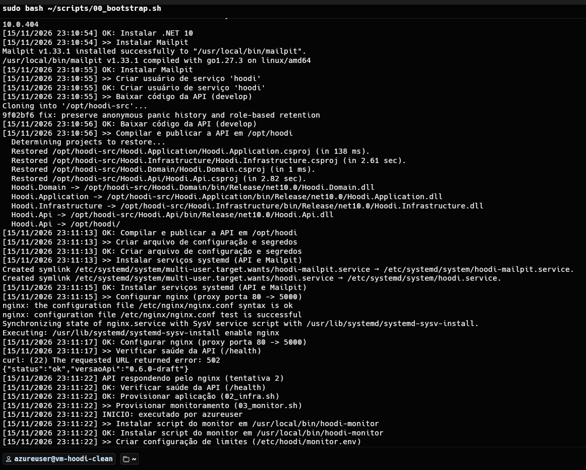

**02. Bootstrap concluído: VM provisionada do zero em 107s**
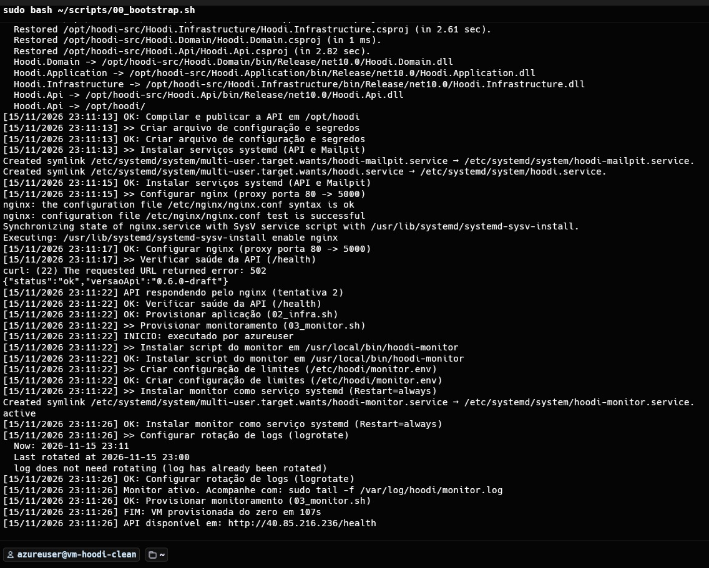

### Infraestrutura

**03. Hostname, fuso, DNS e firewall configurados**
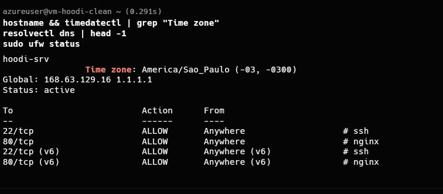

### Aplicação

**04. Serviços ativos e `Restart=always`**
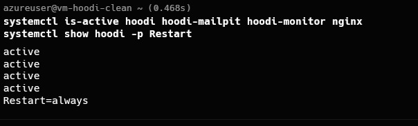

**05. `/health` respondendo a partir de fora da VM**
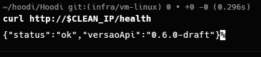

**06. Documentação Scalar acessível pelo IP público**
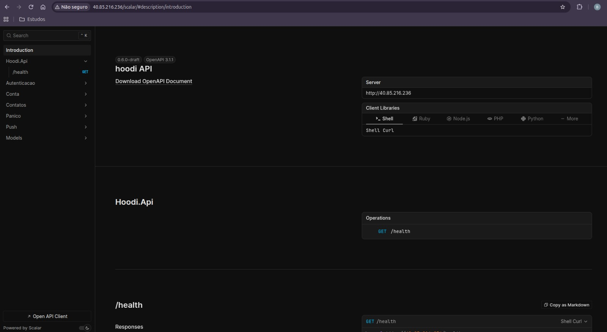

### Monitoramento e testes de falha

**07. `monitor.log`: medições a cada 30s e alerta de disco**
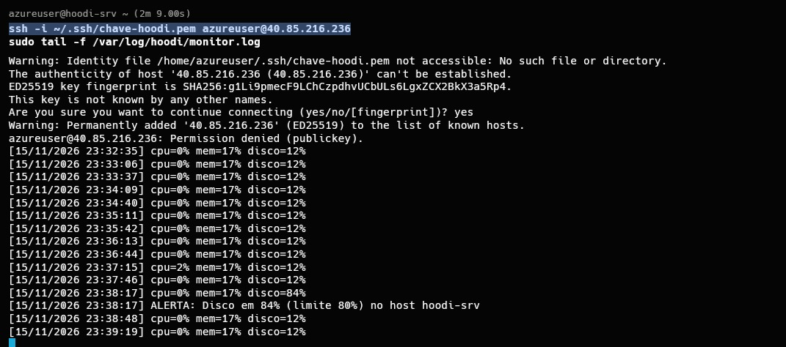

**08. Teste de disco: 84% → alerta → limpeza**
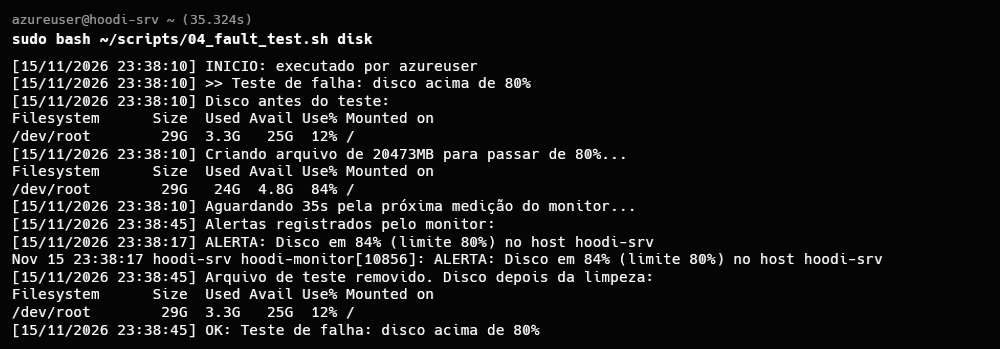

**09. Teste da API: `kill -9` e recuperação pelo systemd (PID 8272 → 11094)**
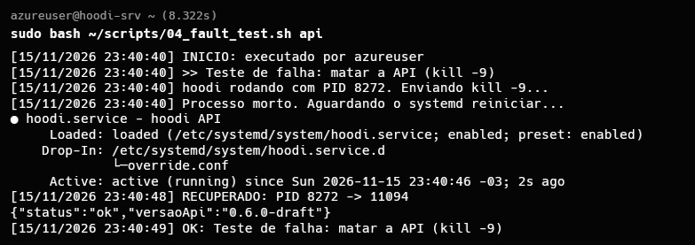

**10. Teste do monitor: `kill -9` e recuperação (PID 8586 → 11280)**
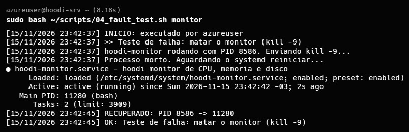

### Auditoria

**11. `audit.log` com o provisionamento completo e os testes de falha**
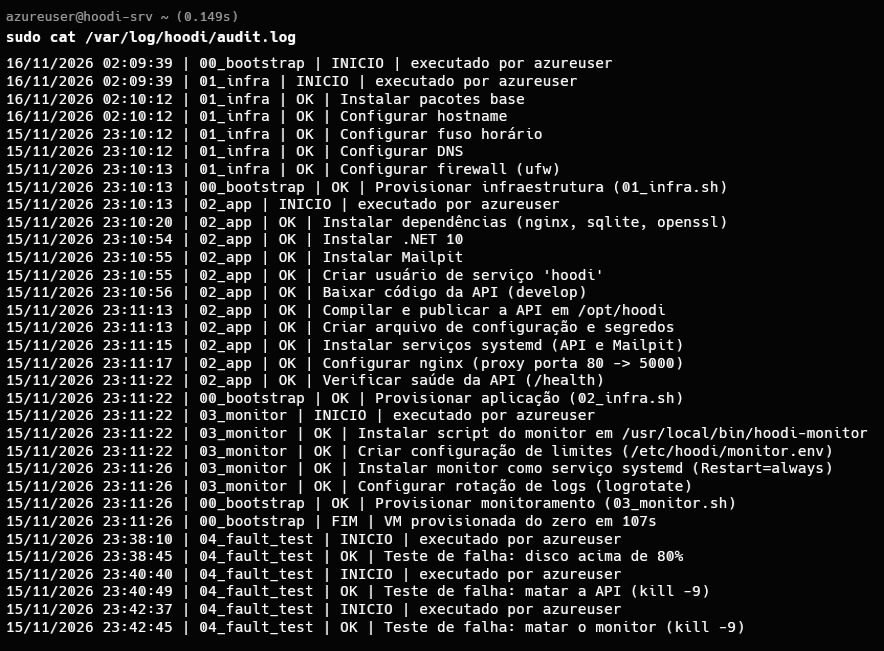

### Fluxo completo da API

Teste de ponta a ponta com dados fictícios: cadastro → e-mail → confirmação → login.

**12. `POST /v1/auth/registrar` → 202**
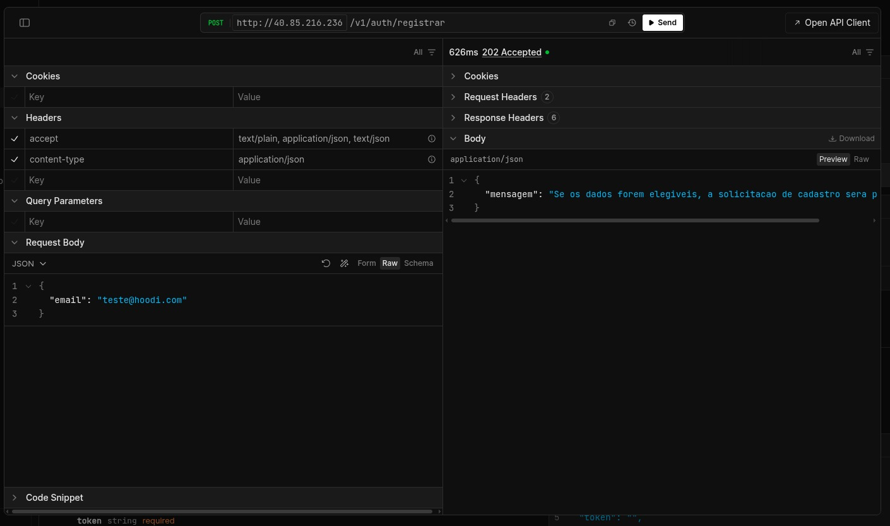

**13. E-mail de confirmação recebido no Mailpit (via túnel SSH)**
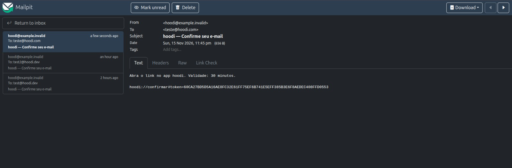

**14. `POST /v1/auth/confirmar-email` → 200**
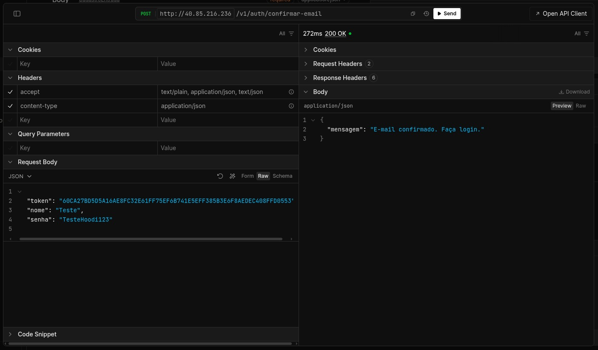

**15. `POST /v1/auth/login` → 200 com access token (JWT) e refresh token**
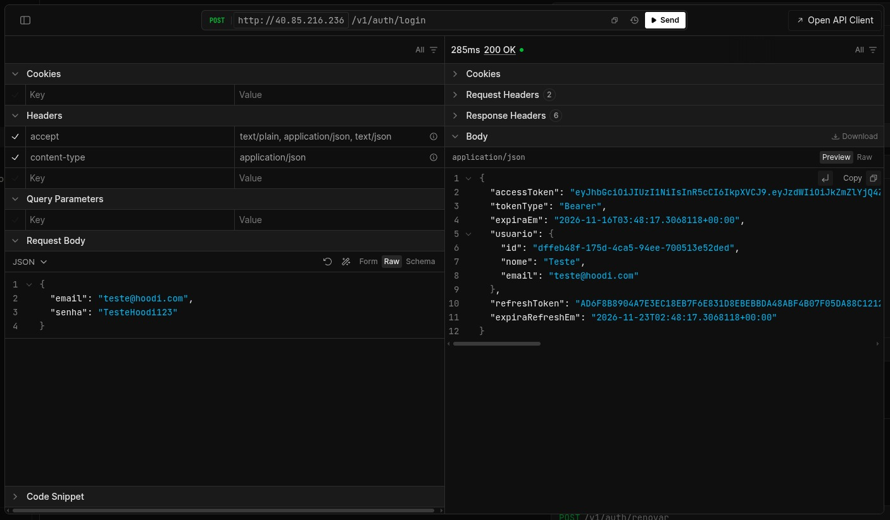
